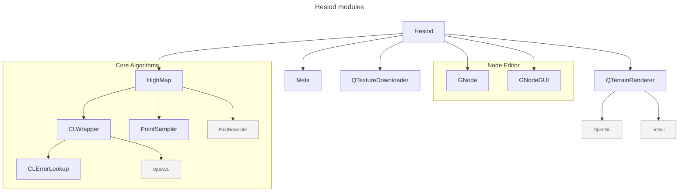

# Hesiod - https://hesiodengine.com

A desktop application for node-based procedural terrain generation.
- binaries: https://hesiodengine.com/#download
- Discord: https://discord.gg/HBgFCjdV8W
- tutorial videos (WIP): https://www.youtube.com/@Hesiod-s9n
- documentation (WIP): https://hesiodengine.com/docs/
- roadmap: https://github.com/ottolink-dev/Hesiod/discussions/608

>[!WARNING] 
> Work in progress, use at your own risk!


## License

This project is licensed under the GNU General Public License v3.0.

## Getting started

### Standalone executables for Windows and Linux

Download from https://hesiodengine.com/#download and choose **Stable** or
**Dev build**. Extract the entire ZIP and keep the bundled runtime files and
`data` folder together. On Windows, run `hesiod.exe`; on Linux, run
`chmod +x hesiod.AppImage` followed by `./hesiod.AppImage` from the extracted folder.

See the [installation guide](docs/getting_started/installation.md) for platform
requirements, troubleshooting and the status of experimental macOS packages.

### Nix / NixOS

The repository is a Nix flake. To try Hesiod without installing anything:

``` bash
nix run 'git+https://github.com/ottolink-dev/Hesiod?ref=main'   # main branch
nix run 'git+https://github.com/ottolink-dev/Hesiod?ref=dev'    # development branch
```

Use the `git+https://` form: the `github:` shorthand fetches a tarball that
does not include the submodules, and the flake refuses to build such a tree.

To install it on NixOS, add the flake as an input and put
`hesiod.packages.${system}.default` in `environment.systemPackages`
(an overlay is exported as `overlays.default` too). GPU acceleration needs
an OpenCL ICD on the host, for instance `hardware.graphics.extraPackages`
with your vendor's OpenCL package on NixOS.

The launcher runs Hesiod from `~/.local/share/hesiod` (honouring
`XDG_DATA_HOME`), where the packaged `data/` directory is symlinked and
run-time files such as the texture cache are written.

### Windows

#### Getting the sources

Use `PowerShell` to clone the repository (because Visual Studio won't clone the submodules) using `git` command lines:
``` bash
git clone --recurse-submodules https://github.com/ottolink-dev/Hesiod.git
```

Submodules are fetched over https; no GitHub account is required to build.

Install [Qt6](https://doc.qt.io/qt-6/windows.html) and install the missing OpenSource dependencies using `vcpkg`:
```
vcpkg install glfw3 opengl gsl glew freeglut glm libpng glm opencl assimp spdlog opencv[openexr]
```

You should then be able to build the sources using Visual Studio.

### macOS / Apple Silicon (experimental)

The native macOS path uses the existing OpenGL viewer and Apple's OpenCL
framework. A Metal backend is not required for this development build.

Install Apple's Command Line Tools (`xcode-select --install`) and native ARM
[Homebrew](https://brew.sh), then install the dependencies:

```bash
brew install cmake ninja qt spdlog nlohmann-json glm assimp opencv fftw gsl \
  libomp openexr libtiff zstd glfw opencl-headers opencl-clhpp-headers
git submodule update --init --recursive
bash scripts/build-macos.sh
```

The script configures an ARM64 Release build in `build/macos` and builds with
two jobs. Set `HESIOD_BUILD_JOBS` to change the parallelism. Additional script
arguments are passed to CMake. The first configure also downloads HighMap's
FetchContent dependencies and needs network access.

Launch the development app:

```bash
open build/macos/bin/Hesiod.app
```

The build script applies the tracked patches in `scripts/macos/patches` to the
pinned HighMap and Meta submodules. They add a missing OpenCL hash helper,
handle Apple's OpenMP compiler flags, limit OpenCV to the used components,
and include a required standard header.
This leaves those submodules with local source modifications; keep the patches
until the fixes are available in newer pinned dependency commits.

The development bundle uses Homebrew libraries. To create a standalone app and
ZIP (Python 3.11 or newer is required):

```bash
python3 scripts/macos/package_app.py --output output/macos-package
python3 scripts/macos/verify_bundle.py output/macos-package/Hesiod.app
```

Use a fresh output directory for each packaging run. The package contains Qt,
the WebEngine helper/resources, required plugins, other runtime libraries,
the application data, licenses, source revision information and dependency
patches. The script creates `hesiod-macos-arm64.zip`, its SHA-256 checksum,
and `verification.json`. The minimum macOS version is derived from all bundled
binaries and recorded in both `Info.plist` and the verification report. Builds
made on newer macOS/Homebrew installations may require a newer OS than CI builds.

The app can be moved into Applications and launched from Finder. Runtime files
and caches go under `~/Library/Application Support/hesiod/runtime/`; preferences
and autosaves use their existing per-user locations. Bundled assets are read
through a symlink from this workspace, keeping the app bundle unchanged.
Command-line project paths are resolved from the caller's original directory.

These packages have an **ad-hoc signature**, required by Apple Silicon, but
no Developer ID signature or Apple notarization. No Apple Developer account is
needed to build them. Downloaded copies may be blocked by Gatekeeper; users
must explicitly approve a trusted build through macOS Privacy & Security.
The SHA-256 file detects download corruption; it does not establish publisher
identity.

`.github/workflows/macos-build.yml` runs the same build on an Apple Silicon
runner for pushes and pull requests to `main`/`dev`, and can be run manually.
It builds and audits the standalone package and uploads the ZIP, checksum,
source information and verification report as a 14-day Actions artifact.
The audit checks every bundled Mach-O, including plugins and the WebEngine
helper, for ARM64 support, dependency closure and valid signatures. Hosted CI
does not test GPU rendering. It does not publish packages to the website.

### Linux

There are also required external dependencies for ubuntu you can execute:
```
sudo apt-get -y install libglfw3 libglfw3-dev libglew-dev libopengl-dev freeglut3-dev libboost-all-dev libeigen3-dev libglm-dev fuse libfuse2 ocl-icd-opencl-dev libassimp-dev qt6-webengine-dev zlib1g-dev
```

> [!NOTE]
> AMD users on Linux may need to install `rocm-opencl` and `rocm-clinfo` for OpenCL compatibility.

#### Getting the sources

Use `git` to retrieve the sources: 
``` bash
git clone https://github.com/ottolink-dev/Hesiod.git
cd Hesiod
git submodule update --init --recursive
```

Submodules are fetched over https; no GitHub account is required to build.

#### Building

Build by making a build directory (i.e. `build/`), run `cmake` in that dir, and then use `make` to build the desired target.

Example:
``` bash
mkdir build && cd build
cmake ..
make hesiod
```

Start the main executable:
```
bin/./hesiod
```

## Profiling with Tracy

Tracy is optional and disabled by default. An instrumented build provides CPU
zones for graph updates, node computations (type, ID, resolution and tiling), and
flattened exports. On Linux it also plots process RSS every 10 ms and the kernel's
process-lifetime peak RSS. This is a starting point for the memory assessment in
[issue 783](https://github.com/ottolink-dev/Hesiod/issues/783).

Install a Tracy client built with `TRACY_ENABLE=ON` and `TRACY_ON_DEMAND=ON`, and
use the same Tracy release for the profiler/capture tools. For example, with the
[Tracy 0.13.1 source](https://github.com/wolfpld/tracy/tree/v0.13.1):

```sh
cmake -S /path/to/tracy -B /path/to/tracy/build-client \
  -DCMAKE_BUILD_TYPE=Release -DCMAKE_INSTALL_PREFIX=/path/to/tracy-install \
  -DTRACY_ENABLE=ON -DTRACY_ON_DEMAND=ON \
  -DTRACY_ONLY_LOCALHOST=ON -DTRACY_NO_BROADCAST=ON
cmake --build /path/to/tracy/build-client --parallel
cmake --install /path/to/tracy/build-client

cmake -S . -B build/tracy -DCMAKE_BUILD_TYPE=RelWithDebInfo \
  -DHESIOD_ENABLE_TRACY=ON -DHESIOD_ENABLE_GENERATE_APP_IMAGE=OFF \
  -DHIGHMAP_ENABLE_BENCHMARKS=OFF \
  -DTracy_DIR=/path/to/tracy-install/lib/cmake/Tracy
cmake --build build/tracy --target hesiod --parallel
cd build/tracy/bin
./hesiod
```

Connect the Tracy profiler to `127.0.0.1`, then load a graph or change a parameter
to trigger computation. Inspect `Node algorithm` zones and their text alongside
the `Process RSS` and `Process peak RSS` plots. Ensure another Tracy-instrumented
application (such as Umbriel) is not occupying the default port, 8086; select the
correct client port if running both. For example, launch Hesiod with
`TRACY_NO_SYS_TRACE=1 TRACY_PORT=8087 ./hesiod` and use port 8087 in the profiler or `-p 8087` with
`tracy-capture`.

For these memory assessments, set `TRACY_NO_SYS_TRACE=1` to disable Tracy's
optional system sampling. The local Tracy 0.13.1 client has intermittently
crashed in `SymbolWorker` / `CallstackDataCb` / `rpmalloc` during shutdown with
system sampling enabled. Explicit CPU zones and Hesiod's RSS plots remain
available with it disabled; failed captures must not count as measurements.

For a batch capture, start `tracy-capture -a 127.0.0.1 -o run.tracy` in another
terminal, then run from `build/tracy/bin`:

```sh
TRACY_NO_SYS_TRACE=1 HESIOD_TRACY_WAIT=1 ./hesiod --batch=/absolute/path/to/graph.hsd \
  --shape=1024,1024 --tiling=1,1 --overlap=0
```

`HESIOD_TRACY_WAIT=1` waits up to 30 seconds for a profiler before starting the
application, and exits with an error if none connects. It has no effect in normal
builds. With on-demand capture, work before connection is not recorded.

For memory scaling, capture the same small graph in fresh processes at 512,
1024, 2048 and 4096 square pixels, increasing gradually as memory permits. Keep
seed, tiling, overlap, storage mode and CPU/GPU mode fixed and record them with
the capture. Compare node timings, RSS plateaus and peak RSS; doubling each axis
quadruples a single float array's storage. Use a tiled run as a separate comparison.

RSS includes the whole process, libraries and profiler overhead. Sampling can
miss short-lived peaks; the kernel peak includes startup and never decreases.
Neither is a per-node allocation total, and neither measures GPU device memory.
These zones do not instrument HighMap's internal `to_array()` / `from_array()`
calls or populate Tracy's allocation view. Use the first captures to choose where
to add those finer zones and allocation hooks before claiming a copy or allocation
bottleneck. Capture overhead should be checked against an uninstrumented build.

### Systematic node assessment

The assessment tools in [`scripts/profiling`](scripts/profiling) require Linux,
Python 3.11+, GNU time, and matching Tracy capture/export tools. Start by refreshing
the inventory from the node factory and compute-function definitions:

```sh
python3 scripts/profiling/inventory.py --output build/tracy/inventory.csv
```

The inventory records source locations, parameter groups, example availability,
and evidence lines. It separates full-array signals (`to_array`, `from_array`,
forced single-array mode), configurable tile dispatch, other code requiring
review, and deprecated entries. These are static triage signals: conversions
can concern geometry rather than heightmaps, tiled callbacks can allocate large
temporaries, and called HighMap functions can hide further materialization.
The inventory describes a full build; minimal-node builds are not representative.

Use this sequence for each assessment batch:

1. Review the relevant branches and ports. Build a minimal deterministic graph
   with a common input, one target, and no preview or export work. Keep an
   input-only baseline and a simple tiled control. Confirm functional output
   separately before using measurements to justify an optimization.
2. Run fresh processes at 512 and 1024 square pixels. Retain failures and stop
   escalation when a process fails, a node logs an error, or a trace lacks a
   completed target zone. Inspect the graphs, settings and traces before expanding.
3. Repeat at least three times, then increase to 2048 and, if memory permits,
   4096. Report median and range for timings and whole-process peak RSS.
   OS/driver caches are not flushed. Keep input, thread count, tiling, overlap,
   storage policy, algorithm variant and CPU/GPU mode fixed within a comparison.
4. Compare tiling and CPU/GPU variants as separate experiments. Include representative
   masks, optional inputs and algorithm parameter groups; one default run never
   establishes coverage of an entire node. Track deprecated aliases separately.
5. Add gather/algorithm/scatter zones and allocation instrumentation only where
   evidence warrants it. File specific optimization findings with reproducible
   graphs, captures, source references and correctness checks.

[`pilot.json`](scripts/profiling/pilot.json) starts with a deterministic
`GaussianPulse` input, `Abs`, CPU approximate `DistanceTransform`, and
`HeightmapToNormalMap`. It fixes one CPU thread, 1x1 tiling and zero overlap,
uses isolated settings, and retains the compiled storage/compute defaults in logs.
Unspecified node parameters retain the defaults of the recorded build.

```sh
python3 scripts/profiling/run_pilot.py \
  --output build/tracy/assessment/run-001 \
  --binary build/tracy/bin/hesiod --baseline build/bin/hesiod \
  --capture /path/to/tracy-capture --exporter /path/to/tracy-csvexport \
  --time-tool /path/to/GNU/time --sizes 512 1024 2048 --repeats 3
python3 scripts/profiling/summarize.py build/tracy/assessment/run-001
```

Output directories must be new. The runner saves fixtures, source/submodule
revisions and dirty status, binary/tool hashes, CMake caches, isolated settings,
application logs, traces, per-run JSON and exported zone/plot CSV. `summary.csv`
contains successful-run counts, timing medians/ranges and process peak RSS;
`coverage.csv` records only the tested pilot variants. Keep failed batches too.
The default trace duration is 10 seconds; increase `--capture-seconds` and
`--timeout` for longer workloads. Missing or truncated zones fail validation.

Do not subtract input-only process peaks and label the difference a node's
allocation total. Startup and allocator retention can dominate RSS. Zones with
fewer than two RSS samples are marked `insufficient_samples`; even longer zones
may contain peaks the sampler misses. GNU time records the kernel's whole-process
peak, including startup and profiler shutdown. The normal and instrumented builds'
CMake configurations must match before making profiler-overhead or speed claims;
the existing Release and RelWithDebInfo builds are separate reference series.

### Overnight sweep (manual launch)

Prepare a frozen suite, then launch it when wanted. Preparation copies the
instrumented executable, application data, scripts, fixtures and tools; it starts
no background work. Run preparation in the build environment (locally,
`direnv exec . python3 ...`) so Qt/OpenCL runtime paths are captured.

```sh
python3 scripts/profiling/overnight.py prepare --output build/tracy/overnight-001
build/tracy/overnight-001/launch
```

The Linux launcher uses a transient **user systemd service**. It survives closing
the terminal; the machine must remain awake and the user service manager must
remain running. There is no timer or recurring schedule. Preparation accepts
`--binary`, `--capture`, `--exporter` and `--time-tool` if tool discovery is unsuitable.

Defaults:

- All non-deprecated registered types receive a report entry. Deterministic,
  typed fixtures exercise one named parameter group/input combination per type;
  this is not exhaustive branch coverage or an output-correctness test.
- 512², 1024² and 2048², three fresh-process repetitions each, Tracy enabled
  with system sampling disabled. Every node at the smallest size is attempted
  before repetitions or larger sizes. Geometry/image-file input fixtures have
  fixed cardinality; their input size does not grow with heightmap resolution.
- Eight-hour total work budget, two-minute per-run timeout, 6 GiB process-group
  RSS stop threshold, plus an 8 GiB hard service memory limit and no swap.
  The launcher applies low CPU/I/O weights; it does not limit GPU device memory.
- Core dumps disabled, 512 MiB per-file limit, and a 20 GiB suite disk budget
  checked between runs (with a 2 GiB free-space reserve). Imports use generated
  local files; exports must produce a nonempty file under the run's `exports/`.
- A failed node keeps its evidence and is excluded from further repetitions
  and larger sizes. Other nodes continue. Missing zones, node errors, crashes,
  resource-limit exits and missing export files cannot count as successful profiles.

`BlenderBridge` remains explicitly `needs_fixture`: it needs an isolated receiver
to measure streaming meaningfully. `Preview` measures backend dispatch only,
because its rendering work is outside the node's compute callback. `Receive`
has two expected invocations in its producer/consumer fixture; its reported time
is their sum. A known overlap-smoothing no-op message is retained separately for
the suite's 1x1, zero-overlap configuration. Short-zone RSS limitations still apply.

The morning report is `report.csv` (also `report.json`), with one row per node,
successful/failed run counts, timing medians/ranges, process peak RSS and reasons
for missing coverage. `status.json` records progress and stop reason; `service.log`
contains the running log. Every completed run also retains its trace, CSV, logs
and result JSON. Reports are updated atomically after each run.

```sh
tail -f build/tracy/overnight-001/service.log
systemctl --user stop hesiod-profile-overnight-001.service
build/tracy/overnight-001/launch --resume
```

Resume reuses completed results, preserves interrupted attempts, enforces the
remaining time budget and rejects changed snapshot/configuration files. Use a
new prepared suite after changing code, fixtures or limits. The run returns
nonzero for incomplete coverage; `finished` means the queue was processed, not
that every node passed. Rebuild a report without executing workloads using
`python3 scripts/profiling/overnight.py report build/tracy/overnight-001`.

## Dependencies and module structures


